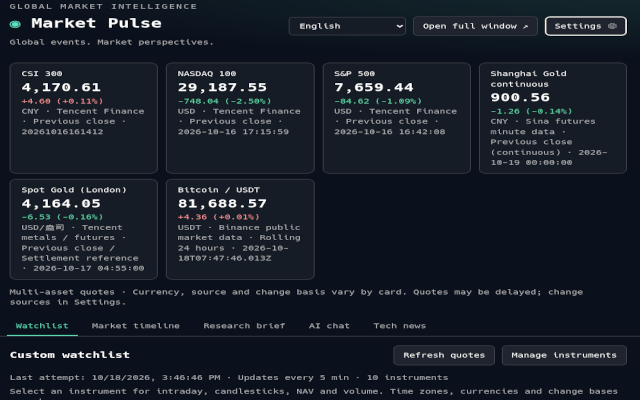
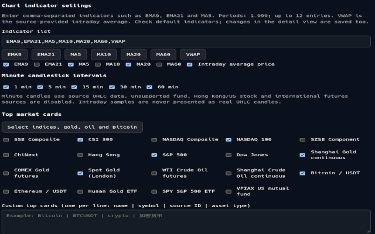
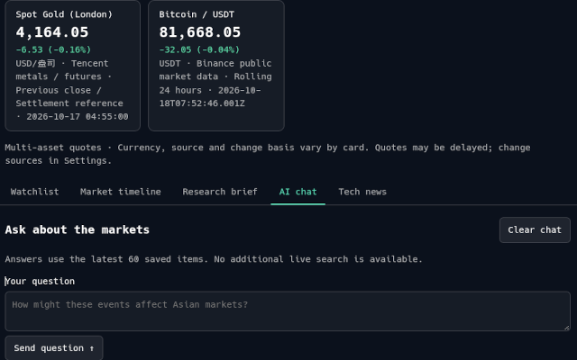
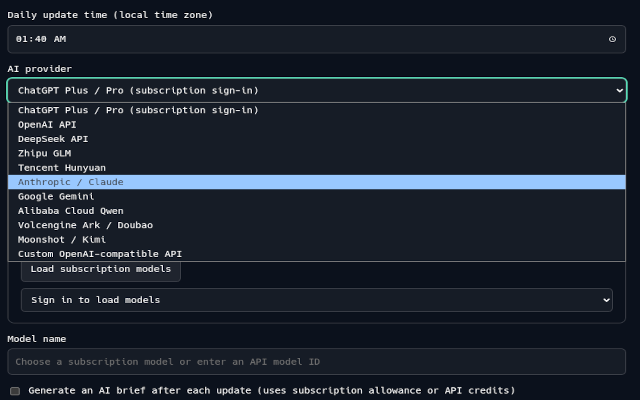
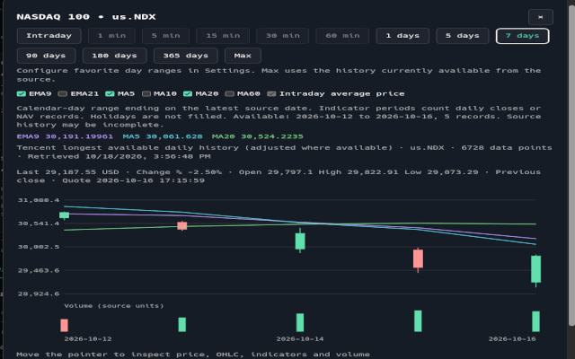
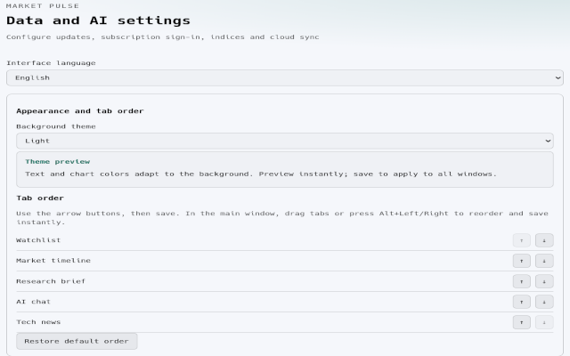

# Market Pulse · Global Markets 1.8.3

[简体中文](README.md) | **English**

A Chrome Manifest V3 extension for daily financial news, exchange rates, market timelines, automatic local digests, AI briefings, and conversations. It includes configurable market cards, a cross-asset watchlist, and interactive charts. AI options include browser-based ChatGPT subscription sign-in and multiple API providers.

## Screenshots



<details>
<summary>View more English screenshots</summary>











</details>

## Installation, updates, and interface

1. Enable Developer mode at `chrome://extensions` and load this directory using **Load unpacked**.
2. To update an existing installation, replace the files in its original directory and click **Reload** to retain local settings.
3. Clicking the toolbar icon opens a resizable **650 × 425** dashboard near the right edge of the display containing the current Chrome window, with approximately 16 pixels of margin. Click again to close it. Losing focus also closes it. Chrome may reduce the window size on smaller displays; the layout adapts to the available width.
4. Right-click the extension icon and choose **Options**, or open **Extension options** from the extension details page. Settings open separately from the dashboard.
5. **Generate AI briefing** on the market timeline switches to the briefing tab and starts generation. **Open full screen** opens the dashboard in a regular browser tab.

## ChatGPT Plus / Pro: sign in inside Chrome

**No local Node service or API key is required for this sign-in mode.**

1. Open Options and select **ChatGPT Plus / Pro**.
2. Click **Continue with ChatGPT** and complete sign-in and subscription usage authorization on the official OpenAI page opened by Chrome.
3. The extension intercepts the callback and verifies the signature inside Chrome. After successful authentication, the account appears in Options. Load the available subscription models, select one, and save.
4. Return to the timeline to generate a briefing or use AI chat. The extension handles subsequent credential renewal.

If authorization fails, the result page and Options display the failing stage, HTTP status, and security error code. Restart sign-in from the extension instead of refreshing an old callback. Signing out removes local account credentials. Sign out before switching accounts. Credentials from the legacy Node bridge are not read; sign in again inside the extension after upgrading.

The implementation follows the official [Sign in with ChatGPT parameters and token protocol](https://developers.openai.com/siwc/token-sharing-open-source/sign-in). That protocol describes a loopback HTTP listener. This extension instead observes loopback navigation in its dedicated authentication tab and immediately redirects to an extension result page. **No local listener needs to run.** The `127.0.0.1` callback address remains a protocol parameter.

The browser adaptation has been tested in real Chrome with mocked OpenAI callbacks, WebCrypto signatures, and model responses. **End-to-end authorization with a real Plus account has not been verified. Server acceptance of the account and client still requires validation.** This implementation should not be interpreted as an officially supported Chrome extension sign-in integration. It does not use shared third-party client IDs, cookies, private ChatGPT website APIs, or a user API key for subscription sign-in.

The extension validates state, PKCE, nonce, signature, issuer, audience, expiry, scopes, and the callback tab. Pending authorization is held in Chrome session storage; credentials remain in local storage and are excluded from synchronization. Inference uses the account-supported `/v1/responses` endpoint with `store:false` and `stream:true`, and requires a completed response event.

## DeepSeek, OpenAI, and compatible APIs

Select a provider in Options and enter its API key, model ID, and base URL:

- DeepSeek: `https://api.deepseek.com`
- OpenAI API: `https://api.openai.com/v1`
- Custom: an HTTPS endpoint; the compatible adapter appends `/chat/completions`.

These API credentials are separate from ChatGPT subscription sign-in. Keys stay in local Chrome storage. Use a model ID available to your account. Automatic AI briefings consume subscription usage or incur API charges after data updates. Without an AI configuration, the extension still generates a local event digest.

## Update schedule, news, and market cards

The daily update time uses the computer's local time zone. Click anywhere in the time field to open its picker, or type a time. Chrome cannot fetch while closed or while the computer is asleep. On startup, the extension checks for missed scheduled updates.

Default financial feeds are BBC Business, the Federal Reserve, and the European Central Bank. Configure 1–15 HTTPS RSS/Atom feeds using one `Name | URL` entry per line. Failures are reported per source, and cached items remain available offline. Up to 500 items from the last 30 days are retained.

Frankfurter daily USD reference rates for EUR, GBP, JPY, CNY, and HKD appear in the timeline and digest with their data dates.

The original index presets include the SSE Composite, CSI 300, NASDAQ Composite, and NASDAQ 100. Version 1.8 expands the banner to multiple asset classes and 20 items; its defaults and source options are described below. Legacy two-column custom entries remain supported:

```text
CSI 500 | sh000905
```

Tencent symbol examples include `sh000001`, `sz399001`, `us.IXIC`, `us.NDX`, and `hkHSI`. Quotes retain provider timestamps and may be delayed. Failed requests retain marked cached values when the source configuration still matches. Public data providers do not offer an availability guarantee controlled by this project.

## Toolbar tracked value and refresh frequency

Choose a displayed market item for the toolbar badge and set a refresh interval of 1, 2, 5, 10, 15, 30, or 60 minutes. You can also disable the badge. Updates are attempted on installation, startup, settings changes, and the configured schedule.

The badge shows a compact value. Its tooltip shows the full value, percentage change, and provider time. An error displays `!` so a cached value is not presented as current. Quotes may be delayed and are not tick-by-tick streaming data. Updates cannot continue while Chrome is closed or the computer is asleep.

## Custom watchlist and detail charts

The **Watchlist** tab includes a shortcut to manage instruments in Options. Enter a code and click **Identify and add** to resolve its name and asset type, save it immediately, and display it in the dashboard. Ambiguous codes require selecting a candidate. Quote failures do not remove configured instruments. Editing, deleting, and adding examples also save immediately. Advanced settings support manual instruments and custom JSON sources.

The watchlist supports up to 30 items, manual refresh, and background intervals of 1/2/5/10/15/30/60 minutes. Version 1.8 adds source routing; for example, legacy `usAAPL` items use Nasdaq daily history by default.

| Asset | Source / adapter | Example codes |
| --- | --- | --- |
| Mainland stocks, ETFs, indices | Tencent | `sh600519`, `sz000001`, `sh518880`, `sh000300` |
| US stocks and ETFs | Nasdaq by default; Tencent and Yahoo are selectable | `AAPL`, `SPY`, legacy `usAAPL` |
| Hong Kong stocks | Tencent; Yahoo is selectable | `hk00700` |
| Mainland mutual funds and gold feeder funds | Tencent NAV quotes and Eastmoney history | `161725`, `002611` |
| Spot gold and silver | International futures / spot metals adapter | `XAU`, `XAG` |
| International futures | International futures adapter | `GC` (gold), `CL` (oil), `SI` (silver) |
| Mainland continuous futures | Sina | `au0`, `rb0` |
| Cryptocurrency pairs | Binance; Coinbase and Yahoo are selectable | `BTCUSDT`, `ETHUSDT` |
| Other supported assets | Custom public JSON | A name, code, and HTTPS URL |

The table displays the latest value, change, percentage, currency/unit, calculation basis, and quote time. Changes distinguish previous-close stock prices, daily fund NAV changes, futures reference prices, and rolling 24-hour cryptocurrency changes. No cross-currency conversion is performed. The timestamp may refer to the latest trading day. If a mainland futures minute source is unavailable, the extension explicitly falls back to daily closing data. Failures appear per row with marked cached values where available.

**Click an instrument name or a top market card** to open its chart:

- Intraday price and reference lines, with an average-price line when supplied by the source or supported by known turnover/volume units.
- Daily OHLC candles and volume. Mutual funds use daily NAV lines, disable intraday trading views, and indicate missing volume.
- Pointer or touch inspection of time, OHLC, average price, and volume.
- Source, quote time, currency/unit, record count, and errors. Maximum history pages backward where supported, with a 20,000-record cap. Pagination failures, source limits, and exhausted history are reported without inventing records.

Volume units depend on the provider: mainland stocks/ETFs may use lots, US stocks use shares, cryptocurrency uses the base asset, and futures use contract units. Check the source for continuous/near-month contracts, adjustments, and price units.

### Custom JSON contract

Use a public HTTPS URL without passwords or API keys. Chrome requests access to that origin when saving. Return the following structure; these values are illustrative, not live market data:

```json
{
  "price": 10.5,
  "previousClose": 10,
  "quoteTime": "2026-10-18 10:00:00 +08:00",
  "currency": "CNY",
  "basis": "Previous close",
  "open": 10.1,
  "high": 10.6,
  "low": 10,
  "volume": 150,
  "history": {
    "minute": [
      {"time":"2026-10-18 09:30", "close":10.1, "volume":100},
      {"time":"2026-10-18 09:31", "close":10.5, "volume":50}
    ],
    "day": [
      {"time":"2026-10-18", "open":10.1, "high":10.6, "low":10, "close":10.5, "volume":150}
    ]
  }
}
```

`price` must be valid. `previousClose` determines change and percentage; alternatively, provide `change` and `percent`. History points may include `average`. Without history, quotes remain available but charts report the missing data. Responses are parsed as JSON, never executed as remote code. Arbitrary API schemas are not automatically inferred.

## Chrome configuration synchronization

Save settings before uploading them to Chrome Sync. On another browser, pull the synced configuration; the extension requests any required source permissions before applying it.

- Sync includes scheduling, AI provider/endpoint/model, automatic briefing preferences, feeds, market cards, toolbar settings, watchlist order, refresh intervals, chart settings, language, theme, tab order, and source configuration.
- API keys, ChatGPT credentials, news, cached quotes, and conversation history are excluded.
- A local API key is retained only when the incoming provider and endpoint match. Otherwise it is cleared.
- Sign in to the same Chrome account and enable extension synchronization. **Both installations must have the same extension ID.** Unpacked extension IDs can depend on directory paths; compare IDs across devices. Chrome Sync isolates data by extension ID.
- Offline writes are queued for later synchronization. A successful write confirms only Chrome's sync storage accepted it; the extension cannot confirm Google server delivery. With synchronization disabled, the storage behaves locally.
- Configurations exceeding the single-item quota are rejected with a message asking you to reduce their size. Offline JSON backup is also available; see version 1.8.2 below.

## Data and privacy

The project has no custom cloud backend. News, API keys, conversations, and sign-in credentials are stored locally in Chrome. Configuration is sent to Chrome Sync only after the user uploads it. AI requests include source context from up to 60 recent news items and up to 16 conversation messages. The assistant has no additional live web-search capability; refer to the original sources.

External news is rendered as text, and article links must use HTTPS. Fetch, AI, and authentication failures are displayed. Keys are not additionally encrypted within Chrome local storage; do not distribute your browser profile or authentication records.

## Development and validation

Generated `.log` files are excluded by `.gitignore` and are not uploaded to GitHub. Validation summaries remain in the documentation; full logs can be generated by running the checks locally.

No npm runtime dependencies or build step are required:

```sh
npm test
npm run check
```

Tests cover missed schedules, deduplication, digests, AI requests, index parsing, credential exclusion from synchronization, browser OAuth, ID-token signatures/nonce/audience/expiry, callback replay, renewal, models, and streaming completion. OpenAI responses are mocked, so these tests do not consume real subscription usage.

Chrome integration testing uses a separate temporary profile and requires no service on port 1455:

```sh
google-chrome --headless=new '--screen-info={1920x1080}' --no-sandbox \
  --disable-gpu --enable-unsafe-extension-debugging \
  --remote-debugging-port=9334 --user-data-dir=/tmp/market-pulse-test about:blank
# In another terminal, from the project directory:
node scripts/gauntlet.mjs
```

The gauntlet runs the complete suite, authentication-core coverage thresholds, a fixed-seed test-file shuffle, three manual mutations, real Chrome functional tests, and a source hash. Integration tests uninstall and reload this directory's extension **in that temporary profile**. Do not point them at your regular browser profile. Real-account authentication and cross-device Google synchronization still require account-level verification.

See [current validation](VALIDATION.md), [historical evidence](EVIDENCE.md), and [acceptance criteria](CHANGE-SPEC.md).

References: [OpenAI sign-in](https://developers.openai.com/siwc/token-sharing-open-source/sign-in), [subscription inference](https://developers.openai.com/siwc/token-sharing-open-source/models-and-inference), [Chrome Storage](https://developer.chrome.com/docs/extensions/reference/api/storage), [DeepSeek](https://api-docs.deepseek.com/api/create-chat-completion/), and [Frankfurter](https://frankfurter.dev/).

## 1.4: Chart ranges and indicators

Select intraday or 1/5/7/90/180-day views from a market card or watchlist detail. Day ranges count calendar days backward from the latest source date and use actual daily bars or NAV records. Weekends are not filled. A one-day view shows the latest daily bar or NAV. Actual dates and counts are displayed when history is incomplete; 180 days are not guaranteed for every instrument.

EMA9 and MA5/10/20/60 can be enabled, with current and historical values available. Daily averages use actual daily records. EMA starts with the first complete simple average, and no line is drawn without enough warm-up data. Indicators are calculated over the complete returned history before slicing the visible range. Intraday EMA9 uses nine source price points rather than nine daily closes. Mutual funds provide daily NAV only.

## 1.5: Configurable ranges, code lookup, and technology news

- Configure common ranges such as 1/5/7/30/90/180/365/730 days or enter integers from 1 to 36,500. Up to 12 ranges are allowed. Intraday and Max remain available. Saved ranges update the dashboard and participate in Chrome Sync.
- Max loads the history currently available from the source. Tencent and Binance page backward in batches of up to 640 and 1,000 records respectively; funds, futures, and custom JSON use their returned history. The general cap is 20,000 records and up to 40 pages where applicable. Max does not guarantee lifetime history. Dense candles may be aggregated for display, while calculations and pointer details use original records. History caching is size-bounded.
- Example inputs: `600519`, `sh518880`, `AAPL`, `161725`, `GC`, `au0`, `BTCUSDT`. Codes such as `000001` can match an index, stock, and fund. `161725` can match an exchange-traded LOF or off-exchange NAV. Select a candidate before adding. Names come from providers; mainland futures names combine contract codes with an asset dictionary. Unknown codes and failed lookups remain available for retry without creating fabricated instruments.
- The **Technology news** tab stores its feeds and status separately from financial news and does not inject them into financial briefings. Filter by AI, software development, major technology companies, computing, 24 hours/7 days/30 days, and keywords. Topics are keyword labels rather than verified editorial classifications.
- Default sources include IT Home, Solidot, SSPAI, the GitHub Blog, Google AI, and Hacker News. Their RSS availability was checked on October 18, 2026. Add/remove RSS or Atom sources in Options or restore defaults. New origins require Chrome permission. Source settings sync; article caches and credentials do not.
- Technology news updates on installation and at the configured daily time. Opening the dashboard checks its cache at least one hour apart; manual refresh is available. Restarting Chrome catches missed daily updates. One failed source does not discard others, and offline mode retains cached items for currently configured sources. A source may not publish new content every day.

The [Binance REST documentation](https://github.com/binance/binance-spot-api-docs/blob/master/rest-api.md#klinecandlestick-data) describes candle cursors and the 1,000-record request limit. Default technology feeds: [IT Home](https://www.ithome.com/rss/), [Solidot](https://www.solidot.org/index.rss), [SSPAI](https://sspai.com/feed), [GitHub](https://github.blog/feed/), [Google AI](https://blog.google/technology/ai/rss/), and [Hacker News](https://news.ycombinator.com/rss).

## 1.6: Languages, configurable indicators, and minute candles

The dashboard and Options support Simplified Chinese, Traditional Chinese, English, and the browser language. Changes save immediately and update open pages, including localized dates and numbers. Language preferences sync through Chrome. The extension management page follows the browser language; the in-app selector controls the application UI. News, user input, and generated AI content retain their original text. New AI requests use the selected language, and local digest labels update with it.

Configure indicators such as `EMA9,EMA21,MA5,MA10,MA20,MA60,VWAP`, with periods from 1–999 and up to 12 entries including VWAP. Choose defaults in Options or toggle them in the detail view, where changes save immediately. EMA starts with a complete-period simple average. Daily periods count daily records; minute-candle periods count bars. Intraday charts use source price-point EMA and a source-provided average price. VWAP is not fabricated from an arithmetic average of prices.

Minute-candle buttons can be configured for 1/5/15/30/60 minutes independently of calendar-day ranges. They use genuine OHLC and volume:

| Asset / source | Support |
| --- | --- |
| Mainland stocks, ETFs, indices (`sh`/`sz`) | Native Tencent `ifzq.gtimg.cn` minute candles; up to 320 bars, exchange-local time |
| Binance pairs | Native candles; up to 1,000 bars; 60 minutes maps to `1h`, UTC |
| Mainland futures (Sina) | Native minute intervals; up to 2,000 bars, exchange-local time |
| Custom JSON | `history.1m`, `history.5m`, `history.15m`, `history.30m`, `history.60m`; explicit OHLC required, up to 2,000 bars |
| Mutual funds and legacy Hong Kong/US stock or international futures/spot adapters | Unsupported minute OHLC is disabled; use available intraday, daily, or NAV views. Version 1.8 adds Yahoo and Coinbase alternatives described below. |

Minute intervals are not display-day ranges. The newest candle may be incomplete, and history length depends on the source. Intraday samples are never used to fabricate OHLC. Tencent mainland 1/5/60-minute and Sina mainland futures 5-minute endpoints returned OHLC in live checks on October 18, 2026. Other intervals have contract tests, but availability is not guaranteed for every instrument. Binance interval mapping follows its [official candle documentation](https://github.com/binance/binance-spot-api-docs/blob/master/rest-api.md#klinecandlestick-data).

Reload the extension at `chrome://extensions` after updating. Existing installations receive default language, indicator, and minute-interval preferences without clearing local data.

## 1.7: Settings shortcut, tab ordering, themes, and AI providers

A settings shortcut next to **Open full screen** opens the separate extension Options page.

Drag dashboard tabs before another tab, or focus a tab and press Alt+Left/Right, to save a new order immediately. Options also provides up/down controls and a reset action; save to apply changes made there. Reordering does not switch the current tab. Reopening the dashboard selects the first configured tab. The order participates in Chrome Sync.

Themes include dark, light, system, and custom background/accent colors. Options previews changes immediately; saving updates open windows and the authentication result page. Text, forms, tables, dialogs, grids, and candles use theme variables. Accents with insufficient contrast are adjusted for readability. Charts retain red for rising values and green for falling values. Theme settings sync.

Additional AI providers use these protocols; ChatGPT retains its separate subscription sign-in:

| Provider | Default API base URL | Protocol |
| --- | --- | --- |
| Zhipu GLM | https://open.bigmodel.cn/api/paas/v4 | OpenAI-compatible |
| Tencent Hunyuan | https://api.hunyuan.cloud.tencent.com/v1 | OpenAI-compatible |
| Anthropic / Claude | https://api.anthropic.com/v1 | Native Messages |
| Google Gemini | https://generativelanguage.googleapis.com/v1beta | Native generateContent |
| Alibaba Cloud Qwen | https://dashscope.aliyuncs.com/compatible-mode/v1 | OpenAI-compatible |
| Volcengine / Doubao | https://ark.cn-beijing.volces.com/api/v3 | OpenAI-compatible |
| Moonshot / Kimi | https://api.moonshot.cn/v1 | OpenAI-compatible |

OpenAI, DeepSeek, and custom compatible endpoints remain supported. API providers require their own API keys and available model IDs, rather than website subscriptions. Switching providers fills the default endpoint and clears the key/model fields; editing the endpoint also clears the key. Regional endpoints and private gateways are configurable and require Chrome origin permissions. All keys remain local and are excluded from Chrome Sync.

Claude uses separate `system`, `max_tokens`, and `x-api-key` fields. Gemini uses `systemInstruction`, user/model roles, and the `x-goog-api-key` header. Keys are not placed in URLs. Only answer text is extracted; reasoning fields are not displayed. Truncation, empty output, and Gemini blocking are detected. Requests prohibit redirects to prevent credentials from following a changed destination. Provider documentation links are available in Options.

References checked on October 18, 2026: [GLM](https://docs.bigmodel.cn/api-reference/模型-api/对话补全), [Hunyuan](https://cloud.tencent.com/document/product/1729/111007), [Claude](https://platform.claude.com/docs/en/api/messages/create), [Anthropic browser request header](https://github.com/anthropics/anthropic-sdk-typescript/blob/main/src/client.ts), [Gemini](https://ai.google.dev/api/generate-content), [Qwen](https://help.aliyun.com/zh/model-studio/compatibility-of-openai-with-dashscope), [Volcengine](https://api.volcengine.com/api-explorer/?action=ChatCompletionsText&groupName=%E5%AF%B9%E8%AF%9D%28Chat%29+API&serviceCode=ark&version=2024-01-01), and [Kimi](https://platform.kimi.com/docs/api/overview). Tests use mocked APIs, not real keys, and do not verify account permissions, regional availability, quotas, or model IDs.

## 1.8: Overseas history, multi-asset cards, and selectable sources

US stocks, ETFs, and mutual funds use Nasdaq daily history by default instead of sparse legacy Tencent US history. Existing codes such as `usAAPL` continue to work. These assets open a daily range by default. Mutual funds use NAV lines without fabricated intraday trades or volume. Historical pagination is capped at 20,000 records, with actual dates and limits displayed.

Options includes separate source routes for mainland assets, US stocks/funds, overseas indices, Hong Kong, other overseas assets, mainland mutual funds, mainland/international futures, and cryptocurrency. Adapters include Tencent, Nasdaq, Yahoo, Eastmoney/Sina, Binance, and Coinbase. Overseas indices still default to Tencent. Nasdaq index checks succeeded for COMP and NDX, while SPX and DJI were unsupported in the probe; verify symbols before switching. Yahoo is an optional global source, but timed out in the current network and cannot be claimed as verified available.

Advanced settings allow changing source base URLs, including Yahoo query1/query2 hosts. Responses must still match the selected adapter's format. A public HTTPS JSON URL template can include `{symbol}` and optionally `{period}`. Individual watchlist items can override their source and source symbol. Financial/technology feeds remain independently configurable; the Frankfurter base URL is also editable. New origins require permission, and public source settings participate in synchronization. Do not put secrets in URLs.

The banner supports up to 20 items: domestic/overseas indices, Shanghai continuous gold, New York gold futures, London spot gold, WTI crude, Shanghai continuous crude, Bitcoin, Ethereum, gold ETFs, US ETFs, and mutual funds. Cards show currency, provider, change basis, and provider time, and open charts when clicked. New installations display indices, Shanghai gold, international gold, WTI, and Bitcoin. Upgrades retain prior selections; choose the recommended indices/gold/oil/Bitcoin combination in Options and save to apply it. Any displayed item can be tracked on the toolbar.

Coinbase preserves the quote currency: `BTCUSDT` maps to `BTC-USDT`, not `BTC-USD`. Changes use a rolling 24-hour basis. Supported intervals are 1/5/15/60 minutes and daily; 30 minutes is disabled. Yahoo limits minute-history lengths, while the current Nasdaq adapter is daily-only. Switching a source or item override separates historical and quote caches so old-source prices are not relabeled as new-source data.

Live probes on October 18, 2026 returned 549 history records each for AAPL, SPY, and VFIAX, plus quotes for Shanghai gold, New York gold, WTI, Binance, and Coinbase BTC-USDT. Providers may return delayed or unusual timestamps, which are preserved rather than replaced with fetch time. Direct Node requests to Coinbase failed locally, while separate public HTTPS ticker/stats requests succeeded. Browser tests use deterministic responses and do not establish availability for every network or account.

References: [Nasdaq stock history](https://www.nasdaq.com/market-activity/stocks/aapl/historical), [Nasdaq ETF history](https://www.nasdaq.com/market-activity/etf/spy/historical), [Coinbase candles](https://docs.cdp.coinbase.com/api-reference/exchange-api/rest-api/products/get-product-candles), and [Coinbase 24-hour statistics](https://docs.cdp.coinbase.com/api-reference/exchange-api/rest-api/products/get-product-stats).

## 1.8.1: Detail title localization and watchlist ordering

Preset detail titles use the selected language and update when the language changes while the dialog is open. Symbols are unchanged. Custom names and unrecognized provider names retain their original text.

Each watchlist row in Options has **Move up** and **Move down** controls. Changes save immediately and update the dashboard table without another save action. Order participates in synchronization. The first item cannot move up and the last cannot move down. Reordering while editing continues to target the original item.

## 1.8.2: View synced configuration and offline backups

Configuration uses `chrome.storage.sync`, not the Google Drive API, and creates no Drive files. Only the latest configuration is retained; uploading replaces the prior copy. When Chrome Sync is disabled, this storage works locally. Offline writes wait for browser synchronization and do not confirm server delivery.

**View / refresh synced configuration** shows the latest copy readable by this browser and its configuration fields, timestamp, extension ID, and byte usage. Expand individual fields to inspect JSON. Changes in the sync area refresh the list automatically. An empty area is explicitly reported. Local application settings are not substituted for a missing sync record. Chrome does not expose account synchronization status or server receipt confirmation through this API.

For cross-device issues, sign in to the Chrome browser itself, not just Gmail; enable Chrome synchronization including extension-related settings; and ensure both installations have the same extension ID. Compare IDs in the new panel or at `chrome://extensions`. Unpacked installations from different paths, or development and store builds, may have different IDs. If the second device still has no configuration, export JSON from the source device and import it on the target. Google Drive authorization is not required.

Offline export downloads the current form configuration, including valid unsaved changes. It preserves watchlist order, data sources, charts, language, themes, and other preferences. Import first previews the selected JSON; **Apply imported configuration** replaces and saves local settings. New origins still require Chrome permission. Supported files use this extension's version 1 configuration format, with a 1 MB limit. Invalid, oversized, foreign-application, and unsupported-version files are rejected.

API keys, ChatGPT credentials, news, market caches, and conversation history are neither exported nor imported. An existing local API key is retained only if the incoming provider and endpoint match; otherwise it is cleared. Subscription sign-in remains local to the device. Avoid secrets in user-configured URLs included in sync or exported files.

See the [Chrome Storage documentation](https://developer.chrome.com/docs/extensions/reference/api/storage). Real Chrome local sync storage, downloads, and imports have been tested, but server synchronization across two devices signed in to a real user account has not been verified.

## 1.8.3: Sync status placement

Upload, pull, refresh, and related error messages appear beneath the upload/pull buttons in the **Chrome configuration synchronization** section. Other operations retain their existing status locations.

## License

This project is licensed under the [MIT License](LICENSE).

Copyright © 2026 woodpenker.

## Development credits

Developed by woodpenker with ChatGPT assistance using a Vibe Coding workflow.
