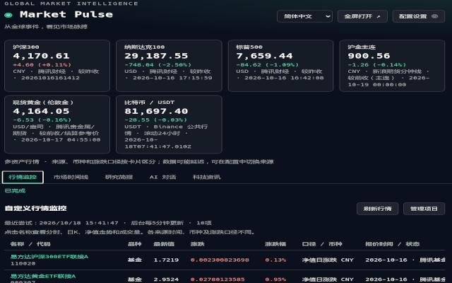
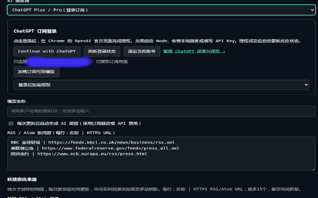
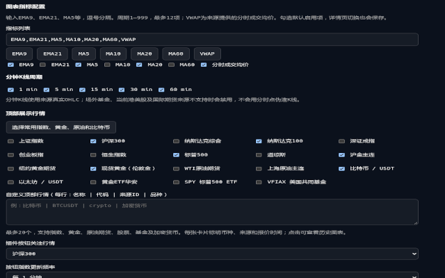
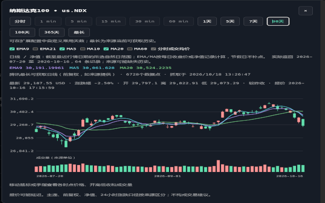
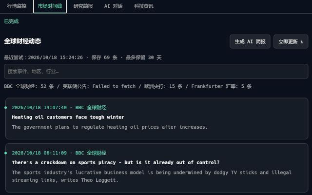
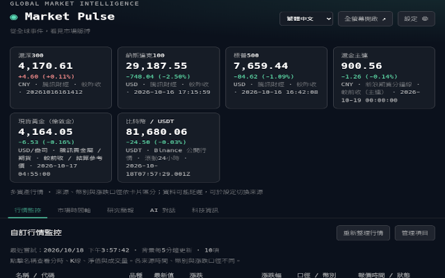
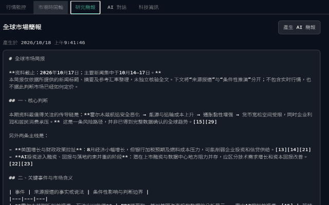
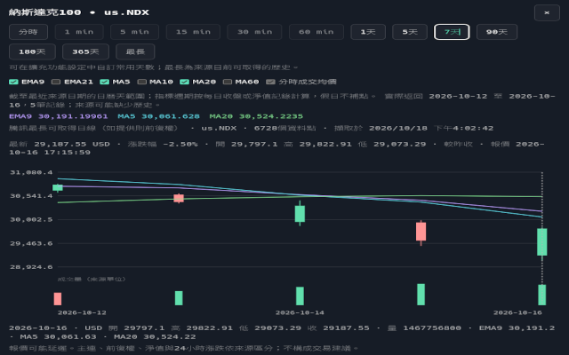
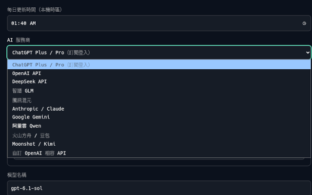
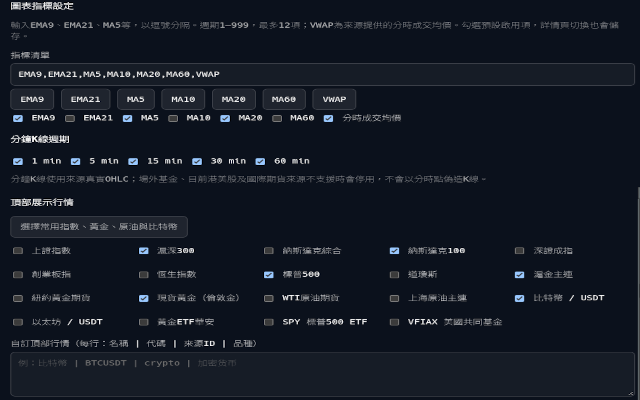

# Market Pulse · 全球市场脉搏 1.8.3

**简体中文** | [English](README.en.md)

Chrome Manifest V3 插件：每日财经新闻与汇率、时间线、自动本地摘要、AI 简报和连续对话。支持 ChatGPT Plus/Pro 登录订阅、DeepSeek/OpenAI API，顶部可配置全球指数，并提供跨资产监控表及可点击的走势详情。

## 界面截图



<details>
<summary>查看更多中文截图</summary>



















</details>

## 安装、更新和界面

1. 在 `chrome://extensions` 开启开发者模式，加载已解压的本目录。
2. 已安装者在原目录更新文件后点击「重新加载」，保留原扩展本机配置。
3. 左键点击工具栏图标，打开默认 **650 × 425** 的独立浮窗，靠当前 Chrome 窗口所在显示器的右侧排列，保留约 16px 边距。再次点击关闭；失去焦点自动关闭。屏幕不足时 Chrome 会缩小窗口；页面随窗口宽度排列，宽屏时间线两列，窄屏一列。
4. 右键插件图标 →「选项」，或在扩展详情点击「扩展程序选项」，打开独立配置页。业务浮窗只显示时间线、研究简报、AI 对话。
5. 时间线点击「生成 AI 简报」，会切换至研究简报并立即生成。可用「全屏打开」在普通标签页查看。

## ChatGPT Plus / Pro：直接在 Chrome 登录

**无需安装或启动 Node 服务，也无需填写 API Key。**

1. 打开插件选项，选择「ChatGPT Plus / Pro（登录订阅）」。
2. 点击 **Continue with ChatGPT**，在 Chrome 新开的 OpenAI 官方页面完成登录及订阅用量授权。
3. 扩展接管授权回调并在 Chrome 内验证签名；成功后配置页自动显示账号。点击「加载订阅可用模型」，选择模型并保存。
4. 返回时间线生成简报，或使用 AI 对话。后续授权续期由 Chrome 插件处理。

若失败，授权结果页和配置页显示具体阶段、HTTP 状态及安全错误码。请从插件重新发起登录，不要反复刷新旧回调。退出可删除 Chrome 内的账号凭据；切换账号请先退出。旧版 Node 服务凭据不会被读取，升级后需在插件中重新登录。

实现沿用官方 [Sign in with ChatGPT 参数和令牌协议](https://developers.openai.com/siwc/token-sharing-open-source/sign-in)。官方文档描述的是 loopback HTTP listener；本扩展将这一传输层改为监听其专用登录 tab 的 loopback 导航，并立即切换到扩展授权结果页，**不需要启动本地服务**。回调地址中的 `127.0.0.1` 仍是协议参数，不意味着需要运行 Node。

这一浏览器适配已在真实 Chrome 内通过模拟 OpenAI 上游的回调、WebCrypto 签名、模型目录测试。**尚未用真实 Plus 账号完成端到端授权，OpenAI 服务端是否允许该账号/客户端仍待用户验证**，不能将此等同于官方已声明支持 Chrome 扩展专用登录集成。未使用第三方共享客户端 ID、Cookie、ChatGPT 网页私有接口或用户 API Key。

state、PKCE、nonce、签名、issuer、audience、有效期、scopes 和回调 tab 均校验。待授权事务仅存在 Chrome session 存储，授权凭据存本机 Chrome local 存储，不进入同步。AI 直接调用账号支持的 `/v1/responses`，要求 `store:false`、`stream:true`，只接受完成事件。

## DeepSeek、OpenAI 和兼容 API

配置页选择服务商，填写 API Key、模型 ID 和 Base URL：

- DeepSeek：`https://api.deepseek.com`
- OpenAI API：`https://api.openai.com/v1`
- 自定义：HTTPS 地址，程序追加 `/chat/completions`。

这些模式的 API Key 与 ChatGPT 订阅登录独立。API Key 只存本机 Chrome 存储；模型 ID 填写账户支持的名称。启用自动 AI 简报会在每次数据更新后使用订阅用量或产生 API 费用。未配置 AI 时仍会自动生成本地事件摘要。

## 更新时间、新闻和指数

每日更新时间采用本机时区，点击时间输入框任意位置打开选择器，也支持键盘输入。浏览器关闭、电脑休眠时无法准时联网；启动时会检查最近一次设定时刻是否已更新并补拉。

默认新闻源：BBC Business、美联储、欧洲央行。支持 1–15 个 HTTPS RSS/Atom，每行 `名称 | URL`。每个源独立报告失败，断网保留缓存。最多保存最近 30 天的 500 条记录。

Frankfurter 每日美元兑 EUR、GBP、JPY、CNY、HKD 参考汇率会进入时间线和摘要，带数据日期。

Banner 默认显示：上证指数、沪深300、纳斯达克综合、纳斯达克100。可在配置中选择其他预置指数，或增加自定义项目，每行 `名称 | 腾讯财经代码`，例如：

```text
中证500 | sh000905
```

最多展示 12 个。A股代码如 `sh000001`、`sz399001`；美国指数如 `us.IXIC`、`us.NDX`；香港如 `hkHSI`。从腾讯财经公共行情端点抓取，打开业务窗口时与每分钟检查更新，失败保留已有缓存并标注。报价时间采用供应商原始市场时间，行情可能延迟；公共源未提供本项目可控制的可用性保障。

## 工具栏关注指数与刷新频率

配置页选择「插件按钮关注指数」，并设置后台更新频率：1、2、5、10、15、30 或 60 分钟。所选指数需先勾选在展示列表中，也可选择「不显示」。安装/启动和保存时立即尝试更新，后台按所设周期拉取。

按钮徽标空间有限，显示紧凑数值；悬停显示完整点位、涨跌幅和供应商时间。失败时显示 `!`，避免把缓存当作最新数值。报价可能延迟，非逐笔实时推送；Chrome 关闭或休眠时无法持续更新。

## 自定义行情监控与详情图

业务窗口提供「行情监控」。点击「管理项目」直达配置页，输入代码并点击「识别并添加」，名称与品种自动填充，立即保存并在主界面列表展示。代码匹配多个品种时需要选择候选；报价失败也保留项目并显示错误。编辑、删除与添加示例同样立即保存。高级设置保留手工来源及自定义 JSON。最多30项，支持1/2/5/10/15/30/60分钟后台刷新，表格可手动立即刷新。

| 品种 | 数据源选择 | 代码示例 |
| --- | --- | --- |
| 国内股票、ETF、指数 | 腾讯股票 / ETF / 指数 | sh600519、sz000001、sh518880、sh000300 |
| 美国 / 香港股票 | 腾讯股票 / ETF / 指数 | usAAPL、usTSLA、hk00700 |
| 场外基金 / 黄金联接基金 | 腾讯场外基金净值 | 161725、002611 |
| 现货黄金 / 白银 | 国际期货 / 现货贵金属 | XAU、XAG |
| 国际期货 | 国际期货 / 现货贵金属 | GC（纽约黄金）、CL（原油）、SI（白银） |
| 国内期货主连 | 国内期货（新浪） | au0、rb0 |
| 加密货币交易对 | Binance 加密货币 | BTCUSDT、ETHUSDT |
| 其他来源支持的任意品种 | 自定义公开 JSON | 自定义名称、代码、HTTPS URL |

表格显示最新值、涨跌、涨跌幅、币种/单位、计算口径和报价时间。股票较昨收、场外基金净值日涨跌、期货参考价/前收、加密货币滚动24小时分别标注，不进行跨币种转换。数据日期可能为最近交易日，行情并非逐笔推送；国内期货分钟源不可用时明确退回日线收盘。接口失败逐行显示并保留带标记的缓存。

**点击监控项名称或顶部指数卡片**打开详情：

- 分时价格线、参考价线；在来源提供或成交额/成交量口径已知时绘制黄色均价线。
- 日K开高低收、成交量柱；场外基金改为每日净值曲线，并禁用分时，缺少成交量时明确标注。
- 移动鼠标或触摸查看时点、开高低收、均价和成交量。
- 显示来源、报价时间、币种/单位、数据点数量及错误。历史长度由数据源决定；最长模式会分页继续请求更早日线，最多20000条。来源停止返回、分页失败或达到上限时显示说明，不补造记录。

图表成交量依来源：A股/ETF常以手、美国股票以股、加密货币以基础币、期货按合约数据。代码所代表的主连/近月、复权和计价单位需结合来源确认。

### 自定义 JSON 契约

只填写公开 HTTPS URL，不放密码或 API Key。保存时 Chrome 请求该域名权限。接口返回如下结构（仅为格式示例，不是真实行情）：

```json
{
  "price": 10.5,
  "previousClose": 10,
  "quoteTime": "2026-10-18 10:00:00 +08:00",
  "currency": "CNY",
  "basis": "较昨收",
  "open": 10.1,
  "high": 10.6,
  "low": 10,
  "volume": 150,
  "history": {
    "minute": [
      {"time":"2026-10-18 09:30", "close":10.1, "volume":100},
      {"time":"2026-10-18 09:31", "close":10.5, "volume":50}
    ],
    "day": [
      {"time":"2026-10-18", "open":10.1, "high":10.6, "low":10, "close":10.5, "volume":150}
    ]
  }
}
```

`price` 必须有效；`previousClose` 用于计算涨跌和涨跌幅；未提供时可另给 `change`、`percent`。历史点可选 `average`。价格来源不返回历史时仍可看表格及报价，但图表会显示缺失说明。响应只按 JSON 解析，不执行远程代码；数据必须自行匹配该契约，不自动猜测任意 API 字段。

## 一键 Chrome 配置同步

在配置页先保存，再点击「上传配置到 Chrome 云端」；在另一台浏览器点击「从 Chrome 云端拉取配置」，会申请需要的源权限并应用配置。

- 同步时间、AI 服务商/接口/模型、自动简报开关、新闻源、指数选择、按钮关注指数与刷新频率、监控项目及监控刷新频率。
- 不同步 API Key、ChatGPT OAuth 凭据、新闻、聊天记录。
- 拉取到相同服务商和接口时保留本机 API Key；服务商或接口变化时清空，避免把密钥带到新地址。
- 需在 Chrome 登录相同账户并开启扩展同步，**两端扩展 ID 必须相同**。未上架的解压扩展 ID 可能受目录路径影响，跨设备请核对 ID；Chrome Sync 以扩展 ID 隔离数据。
- Chrome 离线时暂存，联网后继续同步；上传成功表示已写入 Chrome Sync，插件不能确认 Google 云端已收到。Chrome 未开启同步时仅本地暂存。
- 配置超过 Chrome Sync 的单项大小限制会提示减少新闻源或指数。

## 数据与隐私

没有自建云服务器。新闻、API Key 和对话保存在本机 Chrome 存储；登录凭据保存在 Chrome 本机存储；配置只有用户点击上传后才交给 Chrome Sync。AI 会收到最近最多 60 条新闻的来源上下文及最多 16 条对话消息。它没有额外的实时搜索能力，需结合原始来源判断。

外部新闻按文本显示，文章链接仅允许 HTTPS。所有抓取错误、AI 接口错误和授权失败会显示提示。密钥未在 Chrome 本地存储中额外加密，不要分发自己的浏览器配置或登录记录。

## 验证与开发

运行生成的 `.log` 文件由 `.gitignore` 排除，不上传 GitHub；文档保留验证摘要，完整日志可在本地运行检查后生成。

无 npm 运行依赖，无构建步骤：

```sh
npm test
npm run check
```

当前测试包含调度补拉、去重、自动摘要、AI 请求、指数解析、同步排除密钥，以及浏览器内 OAuth 登录、ID token 签名/nonce/audience/有效期、回调重放、续期、模型和流式回答等。测试以模拟 OpenAI 服务端执行，不消耗真实订阅额度。

Chrome 集成测试使用独立临时配置，不需要在 1455 端口启动任何服务：

```sh
google-chrome --headless=new '--screen-info={1920x1080}' --no-sandbox \
  --disable-gpu --enable-unsafe-extension-debugging \
  --remote-debugging-port=9334 --user-data-dir=/tmp/market-pulse-test about:blank
# 在另一个终端，从项目目录运行：
node scripts/gauntlet.mjs
```

Gauntlet 执行完整测试、登录安全核心覆盖率门槛、固定 seed 的文件顺序重排、3 个手动变异、真实 Chrome 功能测试及源码哈希。Chrome 集成测试会卸载并重新加载**该临时配置中**本目录扩展，不要指向日常浏览配置。真实账号登录与跨设备 Google 云端同步尚需在用户账号下确认。

当前变更验证：[VALIDATION.md](VALIDATION.md)。历史版本证据：[EVIDENCE.md](EVIDENCE.md)。本轮验收标准：[CHANGE-SPEC.md](CHANGE-SPEC.md)。

参考：[OpenAI 登录流程](https://developers.openai.com/siwc/token-sharing-open-source/sign-in)、[订阅推理](https://developers.openai.com/siwc/token-sharing-open-source/models-and-inference)、[Chrome Storage](https://developer.chrome.com/docs/extensions/reference/api/storage)、[DeepSeek](https://api-docs.deepseek.com/api/create-chat-completion/)、[Frankfurter](https://frankfurter.dev/)。

## 1.4 详情图周期与指标

点击指数卡片或监控表名称，选择分时、1/5/7/90/180天。天数按最近行情日期向前计算自然日，使用来源的日线或净值，周末不补点；1天显示最近一天的日K或净值。来源历史不足时，实际日期与条数会在图下说明，不能保证每个标的拥有完整180天记录。

勾选 EMA9、MA5/10/20/60 显示均线并查看最新值，指针移动可查看历史值。日线均线按实际交易记录计算；EMA以首9点简单均值初始化，历史不足不绘制。先使用完整返回历史计算，再截取可见范围，避免切换范围改变指标。分时仅启用9个来源价格点的EMA9和来源提供的成交均价，不把分钟均线标成日均线。场外基金仅有每日净值。

## 1.5 可配置周期、代码添加与科技资讯

- 配置页「行情图表周期」可选择常用 1/5/7/30/90/180/365/730 天，也可输入1–36500之间的自然日整数，最多12个；分时和最长按钮始终保留。保存后主界面按钮同步更新，Chrome配置同步也包含这些天数。
- 「最长」显示来源当前可获取的日线/净值历史。腾讯以640条、Binance以1000条向前分页；基金、期货及自定义JSON保留来源实际返回历史。最多20000条、40次分页，遇到限制会提示；最长不是所有市场统一的固定天数，也不承诺来源包含上市以来全部数据。长历史按显示密度合并绘制K线，指标计算和指针详情使用原始记录；历史缓存有容量约束。
- 示例代码：`600519`、`sh518880`、`AAPL`、`161725`、`GC`、`au0`、`BTCUSDT`。`000001`可同时匹配上证指数、平安银行与场外基金，`161725`可匹配场内LOF与场外净值，选择后添加。名称来自行情源；国内期货名称由合约代码及品种字典组合。未知代码或查询失败会显示错误，保留输入供重试，不创建假项目。
- 新增与市场时间线、行情监控并列的「科技资讯」，独立保存新闻与源状态，不混入财经简报。支持主题（AI、软件开发、大厂动态、计算机行业）、24小时/7天/30天和关键词筛选。主题由关键词标注，不能视为内容判断。
- 默认提供IT之家、Solidot、少数派、GitHub官方博客、Google AI官方和Hacker News；已在2026-10-18检查返回RSS。配置页可增加/删除RSS或Atom地址，支持恢复默认；自定义域名保存时申请Chrome访问权限。配置随Chrome Sync上传/拉取，文章缓存和凭据不上传。
- 科技资讯首次安装、每日设定时间更新，打开界面会检查缓存（至少间隔1小时），另有手动刷新；Chrome重新启动会补执行错过的日更。单源失败不影响其他源，离线保留当前配置来源的缓存，界面显示各源错误。不同来源的发布节奏不保证每日都有新内容。

实现依据：[Binance官方REST文档](https://github.com/binance/binance-spot-api-docs/blob/master/rest-api.md#klinecandlestick-data)说明K线支持时间游标与最多1000条分页。默认科技源直接使用各站RSS：[IT之家](https://www.ithome.com/rss/)、[Solidot](https://www.solidot.org/index.rss)、[少数派](https://sspai.com/feed)、[GitHub](https://github.blog/feed/)、[Google AI](https://blog.google/technology/ai/rss/)、[Hacker News](https://news.ycombinator.com/rss)。


## 1.6 多语言、指标配置与分钟K线

主窗口右上角和配置页可切换简体中文、繁體中文、English，或跟随浏览器。切换立即保存并更新已打开的页面，界面日期和数字使用相应地区格式，语言偏好随Chrome Sync同步。Chrome扩展管理页名称/描述由浏览器语言决定，扩展内选择器切换应用界面。新闻、用户输入和已生成的AI内容保留原文；新AI请求会按当前选择的语言回答，本地摘要的界面文字随语言变化。

在配置页「图表指标配置」输入 `EMA9,EMA21,MA5,MA10,MA20,MA60,VWAP` 等指标，支持1–999周期、最多12项（含VWAP），并勾选默认启用项。快捷按钮可添加/移除常用指标。详情页勾选即时保存；配置随Chrome同步。EMA以首个完整周期的简单均值初始化，预热不足会提示；日线按日记录计算，分钟K线按K线条数计算。原有分时图只计算来源价格点的EMA及来源提供的成交均价，不把分钟MA标成日均线。VWAP使用来源成交均价，不自行用价格算术平均冒充。

配置页还可以选择1/5/15/30/60分钟K线按钮，与自然日范围分开。分钟图使用真实OHLC和成交量：

| 品种/来源 | 支持情况 |
| --- | --- |
| A股、境内ETF及指数（sh/sz） | 腾讯 `ifzq.gtimg.cn` 原生分钟K线，最多320根，交易所当地时间 |
| Binance交易对 | 原生分钟K线，最多1000根，60分钟映射为1h，UTC |
| 国内期货（新浪） | 原生指定分钟周期，保留最多2000根，交易所当地时间 |
| 自定义JSON | 提供 `history.1m`、`history.5m`、`history.15m`、`history.30m`、`history.60m`，每根需明确open/high/low/close，最多2000根 |
| 场外基金、当前港美股、国际期货/现货贵金属来源 | 当前无该接口可用的分钟OHLC，按钮禁用，继续使用已有分时或日线/净值 |

分钟周期不等同于显示天数，历史长度按来源返回值显示，最近一根K线可能未完成。不会拿分时采样价格伪造分钟高低开收。实测2026-10-18腾讯A股1/5/60分钟和新浪国内期货5分钟接口返回OHLC；其余周期同时有契约测试，不能保证每个品种都能返回历史。Binance周期及1h映射依据[官方K线文档](https://github.com/binance/binance-spot-api-docs/blob/master/rest-api.md#klinecandlestick-data)。

更新后在 `chrome://extensions` 点击重新加载。已有配置自动使用默认语言/指标/分钟周期，不需要清除本机数据。


## 1.7 设置入口、标签排序、主题与更多AI服务商

「全屏打开」旁新增「配置设置」按钮，直接打开Chrome扩展配置页，业务窗口仍不嵌入配置页。

标签页支持在主窗口拖动排序（拖至目标标签前），或聚焦标签后使用Alt+左右方向键；两者即时保存。配置页可使用上下按钮排序或恢复默认顺序，点击保存后应用。顺序改变不切走当前页面；重新打开业务窗口时进入排在第一的标签。顺序会参与Chrome Sync配置同步。

背景主题支持暗色、亮色、跟随系统、自定义背景和强调色。配置页即时预览，保存后更新所有打开窗口及授权结果页。文字、表单、表格、弹窗、网格和K线均使用主题变量；自定义强调色若对比度不足会自动调整可显示颜色。图表仍使用红涨绿跌。自定义颜色与模式也可同步。

新增服务商按以下接口适配（ChatGPT继续保留原订阅登录）：

| 服务商 | 预置API Base URL | 协议 |
| --- | --- | --- |
| 智谱 GLM | https://open.bigmodel.cn/api/paas/v4 | OpenAI兼容 |
| 腾讯混元 | https://api.hunyuan.cloud.tencent.com/v1 | OpenAI兼容 |
| Anthropic / Claude（本次“A厂”按此处理） | https://api.anthropic.com/v1 | 原生Messages |
| Google Gemini | https://generativelanguage.googleapis.com/v1beta | 原生generateContent |
| 阿里云 Qwen | https://dashscope.aliyuncs.com/compatible-mode/v1 | OpenAI兼容 |
| 火山方舟 / 豆包 | https://ark.cn-beijing.volces.com/api/v3 | OpenAI兼容 |
| Moonshot / Kimi | https://api.moonshot.cn/v1 | OpenAI兼容 |

OpenAI、DeepSeek、自定义兼容API继续可用。新增服务商填写各自API Key和账户可用模型ID，不复用网站会员登录；切换服务商会填入默认接口并清空当前密钥及模型字段，修改接口时也清空当前密钥。API Base可按区域或私有网关修改，保存时需要Chrome域名权限。所有密钥只存本机，Chrome Sync不包含密钥或订阅凭据；不要将ChatGPT订阅凭据填入其他服务商。

Claude使用独立system、max_tokens和x-api-key，Gemini使用systemInstruction、user/model角色以及x-goog-api-key请求头；不把密钥放在URL中。只提取文本回答，不展示思维字段；明确检测截断、空输出及Gemini拦截状态。请求禁止重定向，防止凭据跟随新地址。配置页可查看对应服务商官方文档。

接口依据（2026-10-18核对）：[GLM](https://docs.bigmodel.cn/api-reference/模型-api/对话补全)、[混元](https://cloud.tencent.com/document/product/1729/111007)、[Claude](https://platform.claude.com/docs/en/api/messages/create)、[Anthropic浏览器请求头](https://github.com/anthropics/anthropic-sdk-typescript/blob/main/src/client.ts)、[Gemini](https://ai.google.dev/api/generate-content)、[Qwen](https://help.aliyun.com/zh/model-studio/compatibility-of-openai-with-dashscope)、[火山方舟](https://api.volcengine.com/api-explorer/?action=ChatCompletionsText&groupName=%E5%AF%B9%E8%AF%9D%28Chat%29+API&serviceCode=ark&version=2024-01-01)、[Kimi](https://platform.kimi.com/docs/api/overview)。测试使用模拟API响应，未用真实密钥验证账户权限、地区可用性、额度或模型ID。


## 1.8 海外历史、多资产顶部行情与可切换数据源

美股、美国ETF和共同基金默认使用Nasdaq海外接口获取日线历史，不再依赖腾讯美股接口返回的稀疏历史。保留原有`usAAPL`等项目，无需删除重加。点击这类资产默认进入日线范围；共同基金绘制净值线，不伪造分时或成交量。最大历史按来源分页取得，上限20000条；详情显示实际起止日期和来源限制。

配置页新增「行情与数据源设置」，可按内地、美股、海外指数、港股、其他海外资产、场外基金、国内/国际期货、加密货币分别选择来源。预置腾讯、Nasdaq、Yahoo、东方财富/新浪、Binance、Coinbase等适配。海外指数仍默认腾讯；Nasdaq指数接口已验证COMP、NDX，SPX、DJI在本次探测中不支持，切换前须核对代码与品种。Yahoo提供海外市场补充，但当前网络连接超时，不能保证所在网络可用；失败会显示错误。

高级设置可修改各来源基础地址，例如Yahoo的query1/query2域名；修改地址后响应须保持该适配器格式。也可提供含`{symbol}`及可选`{period}`的公开HTTPS标准JSON模板，作为对应资产类别的自定义来源。自定义监控项目的高级选项可单独覆盖来源与来源代码。新闻/科技RSS继续分别配置；Frankfurter汇率基础地址也可修改。保存新域名时Chrome会请求访问权限，来源配置可参与Chrome Sync，勿在地址中放入密钥。

顶部展示上限20项，可选择国内/海外指数、沪金主连、纽约黄金期货、伦敦现货黄金、WTI原油、上海原油主连、比特币、以太坊、黄金ETF、美国ETF和共同基金。每张卡片显示币种、报价来源、涨跌口径与供应商报价时间，点击进入详情。新安装默认展示指数、沪金、国际黄金、WTI和比特币；升级保留已选项目，在配置页点击「选择常用指数、黄金、原油和比特币」后保存即可应用推荐组合。工具栏关注值可以选择这些行情项目。

Coinbase保持交易对计价币，例如BTCUSDT映射为BTC-USDT，不替换为BTC-USD；涨跌为滚动24小时。支持1/5/15/60分钟和日线，30分钟按钮禁用。Yahoo分钟长度受其接口限制，Nasdaq当前只提供日线适配。切换来源或修改单项来源时，历史缓存与报价缓存按配置区分，不将旧来源报价标成新来源。

2026-10-18真实网络探测：AAPL、SPY、VFIAX分别返回549条日线/净值记录；沪金、纽约黄金、WTI、Binance及Coinbase BTC-USDT公开报价接口返回数据。源端可能延迟或返回异常时间，页面保留来源时间，不把抓取时间当成交时间。Node直连Coinbase在本机有连接失败，另以公开HTTP请求验证其ticker/stats成功；浏览器流程使用确定性响应测试，不等同于所有网络或账户均可用。

接口参考：[Nasdaq股票历史](https://www.nasdaq.com/market-activity/stocks/aapl/historical)、[Nasdaq ETF历史](https://www.nasdaq.com/market-activity/etf/spy/historical)、[Coinbase K线](https://docs.cdp.coinbase.com/api-reference/exchange-api/rest-api/products/get-product-candles)、[Coinbase 24小时统计](https://docs.cdp.coinbase.com/api-reference/exchange-api/rest-api/products/get-product-stats)。


## 1.8.1 详情标题翻译与监控排序

详情页标题对预置行情名称应用当前语言，已打开的详情页也会随语言切换更新。代码保持原样，用户自定义名称与未收录的供应商名称保留原文。

配置页「自定义监控项目」每行新增上移、下移按钮，点击立即保存，不需要再次点击保存设置。监控表按相同顺序展示，顺序参与已有Chrome配置同步。第一项禁用上移，最后一项禁用下移，编辑中排序会继续定位原项目。


## 1.8.2 查看同步配置与离线备份

配置储存在`chrome.storage.sync`，不使用Google Drive API，也不会在Drive里创建文件。当前仅保留一份最新配置，上传替换上一份。Chrome同步未开启时，sync存储仅在本机工作；离线写入会等待浏览器同步，不表示Google服务器已收到。

新增「查看 / 刷新同步配置」：列出当前浏览器可读到的最新同步副本及全部配置字段，显示记录时间、扩展ID、同步区字节用量。每项可展开查看JSON；同步区变化会自动更新列表。列表为空则明确提示，并不把本机设置冒充同步配置。Chrome API不能提供该账号是否已开启同步或服务器收件确认，因此不显示虚假的“云端同步成功”。

跨设备排查：确认登录的是Chrome浏览器账户而非仅登录Gmail网页；开启Chrome同步并允许扩展相关同步；两端必须是相同扩展ID。可在新面板比较ID或打开`chrome://extensions`查看。开发者模式从不同目录加载可能得到不同ID；商店版和开发版也可能不同。若第二台设备仍读不到配置，可在来源设备导出JSON，再在目标设备导入。不需要Google Drive授权。

离线导出使用当前表单配置（包括尚未点击保存的有效修改），生成JSON文件，保留监控顺序、数据源、图表、语言、主题等配置。离线导入选择JSON后先显示预览，点击「应用导入配置」才替换本机配置并保存；所需新域名仍经过Chrome权限申请。支持本扩展version 1格式，最大1MB，无效、过大、其他应用或不支持版本的文件不会应用。

API Key、ChatGPT登录凭据、新闻、行情缓存及对话记录不导出、不从文件导入。若文件中的AI服务商和接口与本机相同，则保留本机已有API Key；切换接口会清空该Key，不把它带往新接口。订阅登录状态保持本机独立管理。同步和导出配置中的用户自行填写URL应避免包含秘密。

参考：[Chrome Storage官方说明](https://developer.chrome.com/docs/extensions/reference/api/storage)。本次验证了真实Chrome本地sync存储、下载与导入流程，未在用户Google账号的两台真实设备间确认服务器同步。


## 1.8.3 同步提示位置

Chrome同步上传、拉取、刷新及相关错误提示显示在「Chrome 配置同步」区域的上传/拉取按钮下方。其他操作保留原有提示位置。


## License

This project is licensed under the [MIT License](LICENSE).


## 开发说明

本项目由 woodpenker 使用 ChatGPT，通过 Vibe Coding 方式辅助开发。
